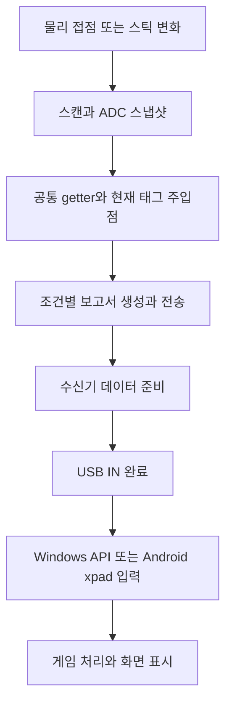

# 1세대 Ultimate Bluetooth 2.4G 성능 개선 계획

2026-11-24. 대상은 원래 80NA 본체1.11과 동봉 수신기1.04이며, 현재 두 세트에 적용한 enhanced 본체와 IN2ms 수신기를 기준점으로 둔다.

우선순위는 **측정 기준과 실제 실행 경로 확인 → 수신기 IN1ms 단독 비교 → 본체에서 확인된 병목 한 곳씩 수정 → 정상 이미지와 셋톱 검증**이다.
IN1ms는 비교적 작은 변경이지만 큰 갱신률 향상을 보장하지 않는다. 350/400Hz는 중간 실험 목표,500Hz는 검증 목표이며 달성한 성능이 아니다.
이 문서는 후속 연구 계획이다. 현재 설치된 펌웨어와 배포 기본값은 그대로 유지한다.

## 1 비교에서 확인한 결론

| 관찰 | 의미 | 다음 판단에 주는 영향 |
|---|---|---|
| 자동 태그 생성244.745→289.081Hz, PC 관측288.970Hz | 두 계측본의 순차 실행에서 약18.12% 차이 | 정상 펌웨어의 물리 버튼 지연이나 순정 대비 효과로 확대하지 않는다 |
| 현재 생성률의 역수는 약3.459ms | 평균 생성 간격의 환산값 | CPU 실행시간3.459ms라는 뜻은 아니다. 처리·대기·스케줄을 분리해야 한다 |
| 실제 수신기 IN2ms, Full-Speed12Mbps | USB에는 약500회/초 서비스 기회가 있다 | 현재289Hz만으로 USB가 유일한 제한이라고 보기는 어렵다 |
| 전송 후보·입력 스냅샷·버튼 읽기 코드는 최종본에서도 대부분 원본과 같다 | 아직 변경하지 않은 검토 지점이 남아 있다 | 실제2.4G에서 실행되는지와 소요시간을 먼저 측정한다 |
| 첫 report5 전용 태그는 수신되지 않았다 | 그 주입점만으로 실제2.4G 경로를 입증하지 못했다 | report5/C4 경로를 현재 RF의 확정 병목으로 부르지 않는다 |
| 기존 source 태그는 공통 axes getter 뒤에서 만들어진다 | 원시 GPIO·ADC보다 뒤의 처리 빈도를 측정했다 | 버튼 접점부터의 지연은 별도 기준 시점이 필요하다 |
| 셋톱 보조 앱은 초기화 후 xpad를 다시 연결한다 | 정상 입력은 커널 드라이버가 처리한다 | Java 진단 함수의100ms timeout을 정상 입력 주기로 오인하지 않는다 |

[정적 비교 집계](../evidence/performance-plan-comparison.json), [이전 계측 집계](../evidence/schedule-comparison.json),
[본체B 검증](../evidence/controller-b-final-validation.json), [수신기B 검증](../evidence/receiver-b-final-validation.json).

### 외부 기본 실측값의 위치

Gamepadla의197.33Hz는 공식1.10·동글/XInput·P82 조건의 외부 참고값이다.
우리의289.081Hz는 공식1.11 기반 수정 계측본의 내부 태그 생성률이다.
수치상46.50% 차이는 있지만 같은 장치·펌웨어·방법의 직접 A/B가 아니다.
다음 연구에서는 **현재 enhanced와의 동일 방법 비교**를 우선하고, 순정 비교가 필요하면 공식1.11에도 같은 계측 코드를 적용한다.
수정 펌웨어에만 태그를 넣고 순정의 다른 공개 숫자를 대조군으로 삼지 않는다.
[외부 측정 조건](../evidence/external-stock-reference.json).

## 2 코드와 공개 구현의 대조

### 현재 최종본에서 바뀐 곳과 남은 곳

공식1.11의 기존 Ghidra 분석을 읽기 전용으로 조회하고,22개 함수의 실제 body 범위를 네 이미지와 비교했다.
함수 목록은 원본 분석의 경계이며 새로 추가한 payload는 별도다. 간접 호출·ROM·미복구 경로까지의 완전한 call graph를 뜻하지 않는다.
body 바이트가 같아도 호출한 함수·전역 상태·timer 변경으로 동작과 소요시간은 달라질 수 있다.

| 영역 | 현재 상태 | 후속 검토 |
|---|---|---|
| 주기 setter0101e9e4 |108바이트 stub으로2ms 계산 수정 | 본체 전역 tick을 다시 줄이는 것은 후순위 |
| 입력 callback0101dae4 | 시작 tick 기준 재등록 추가 | 그 밖의 작업량·늦어진 deadline·실행 빈도를 계측 |
| 분류/처리0101fe34 | 마지막 활동 판정 call 수정, 원본 body3바이트 차이 | 조건별 우회·조기 반환·실제 전송 경로 확인 |
| 스냅샷0102a0f4 | 원본 body와 동일 | 평균·트리거·배터리 읽기의 시간을 구분 |
| 버튼 읽기01024890 | 원본 body와 동일 | 버튼 스캔 완료부터 보고서 반영까지 확인 |
| 공통 axes010241b8 / trigger0101e36c | 정상본은 원본과 동일 | 기존 태그 주입 위치와 실제 센서 입력 시점을 구분 |
| report dispatch010242e4와다른 경로 | 원본 body와 동일 | 활성 분기와 report 형식을 먼저 식별 |
| C4 후보0102ab6e→0101a8a8 | 원본 body와 동일, 상태/시간초과까지 동기 대기 | 실제2.4G에서 실행되는 경우에만 대기 분리 검토 |

동기 대기의 완료 신호가 무선 명령 수락인지 전파 ACK인지 아직 구별하지 않았다.
따라서 timeout 인수를 줄이는 대신, 진입 횟수·완료/timeout 비율·대기시간을 확인한다.
이 반복문은 완료 신호가 오면 바로 반환한다. timeout 상수는 고정으로 기다리는 시간이 아니라 종료 한계이므로, 정상 완료가 빠른 경우 그 숫자를 줄여도 정상 입력은 빨라지지 않는다.

과거 두 진단 이미지도 직접 대조했다.105984바이트 중 차이는 물리 스위치 조건의4바이트뿐이며 공통 getter의태그 코드는 같았다.
이 점은 비교의 근거지만, 순차 실행 두 번만으로 장시간 성능 차이를 확정할 수는 없다.

### 간접 콜백 주소를 확인하는 기준

- ADC 누적 코드0102a074는 원본 리터럴0101b8e4의 Thumb 포인터0102a075로 연결된다.
- run-loop 메서드 포인터01030e50은0102bab7이다. 진입점은0102bab6이고 예전0102bac8 범위는 내부 작업 부분이다.
- 두 위치는 기존 Ghidra 함수 목록에서 빠져 있었지만 원시 포인터/Thumb 증거가 있다. 목록에서 안 보인다는 이유로 잘못된 주소라고 판단하지 않는다.
- 새 hook 전에 함수 시작·끝·리터럴·호출 규약을 다시 복구한다. 내부 명령 주소를 함수 진입점처럼 갈아 끼우지 않는다.

### 공개 프로젝트에서 취할 것

| 비교 자료 | 도움이 되는 부분 | 이번 성능 실험에 바로 합치지 않는 이유 |
|---|---|---|
| alphaorderly의정확한1세대 구현 | 모델 검사·원복·배포 흐름 | 주기 stub과 코드 영역이 겹치고 기능은 wake/remap이다 |
| gomezluisj의80NA/1.11 구현 | 전체 앱 재읽기·모델 경계 | 주 기능이 Switch2 wake/reconnect여서2.4G 속도 수정으로 볼 수 없다 |
| Ultimate2C toolkit | 입력 스캔과 부수 작업 분리, turbo/Home 시간 보존이라는 설계 관점 | Telink 계열의 다른 하드웨어다. 주소·상수·바이너리는 이식하지 않는다 |

2C의 버튼 읽기5→2.5ms와 그 효과는 그 프로젝트의 설명이다.1세대의 버튼 스캔 시간이나 예상 개선량으로 가져오지 않는다.
고정 커밋과 라이선스 구분은 [출처](SOURCES.md)에 있다.

## 3 측정 경계

조건별 우회가 있는 대표 경계도다. 현재 태그는 C 이후를 관측하며 A의 물리 시점을 만들지 않는다.

| 지표 | 필요한 기준 | 판정할 수 있는 것 |
|---|---|---|
| source 생성률 | 같은 위치의 순번과 PC의 충분히 긴 관측 구간 | 태그 지점의 평균 처리 빈도 |
| 실제 USB 새 보고서율 | 수신기 대상 USB 완료 기록과 payload 순번 | PC API 이전에 보인 새 보고서와 반복 보고서 구분 |
| 전송 대기시간 | 본체 내 같은 clock의 진입/완료 기록 | 해당 코드 구간의 체류시간. 신호 의미는 별도 해석 |
| 버튼 접점→호스트 지연 | 전기적 접점 기준과 검증된 수신 시각 | 실제 물리 입력의 평균·중앙값·분위 지연 |
| 셋톱/게임 체감 | 로컬 입력 기록과 별도의 화면 기준 | Android·게임·스트리밍 경로의 영향 |

source와PC clock을 동기화하지 않은 상태에서 두 timestamp를 빼 단방향 지연을 계산하지 않는다.
USBPcap만 있어도 수신기 내부의 데이터 준비 시각이나 접점 시각까지 보이는 것은 아니다.
태그만500Hz로 바뀌어도 버튼이나ADC가500Hz로 새로 측정됐다는 뜻은 아니다. 스캔 완료·유효ADC 갱신·보고서 순번을 따로 확인한다.

## 4 개선 후보와 우선순위

| 후보 | 바꿀 범위 | 기대 효과와 한계 | 착수 조건 | 순서 |
|---|---|---|---|---|
| U1 수신기IN2→1ms | 활성 XInput descriptor와중첩CRC | USB 수신 대기를 줄일 여지. 본체 생성률 상승은 별도 | 동일 계측 기준선·원복·새 파일 해시 |1차 작은 비교 |
| C1 입력 핵심 경로 단축 | 버튼 반영 순서·시간을 쓰는 작업 | 버튼 지연 또는 생성률 개선 가능 | 실제 실행 경로와 구간 시간 확인 |2차 |
| C2 전송 대기 분리 | 확인된 전송 경로의 상태 기계·버퍼 수명 | 긴 동기 대기가 병목이면 큰 개선 여지 | 실제2.4G에서 그 대기 실행·병목 입증 |3차 |
| R1 수신기 큐 처리 | 수신·USB 준비 경로 | 과거 프레임 적체를 줄일 가능성 | 원시 USB 순번과수신기 버퍼 소유권 확인 |자료가 보일 때 |
| 본체 전역1ms tick | 공용 timer·활동·진동 등의 시간 기반 | 기회가 늘어도 처리량이 따라오지 않을 수 있음 | 전체 시간 환산/상태 검증 |후순위 |
| OUT8→4ms | PC→수신기 출력 방향 | 진동/제어 명령 대기 영향. 입력률 개선 근거가 약함 | 출력 부하가 입력에 간섭한다는 계측 |기본 제외 |
| CPU 클럭·GPIO settling·RF timeout 단순 축소 | 하드웨어 시간/보호 동작 | 단위와 역할이 불명확한 변경 | 클럭·전기적 정착·프로토콜 확인 |1차 실험 제외 |

U1의1ms는 **수신기 USB descriptor**다. 본체 setter에 인수1을 넣는 변경이 아니다.
현재 본체 setter의 기존 계산에 작은 인수만 넣으면0과reload underflow가 될 수 있다.
ROM4238의 인수2도2ms라고 확인된 값이 아니므로 삭제하거나 반으로 줄이지 않는다.

### IN1ms에서 기대할 수 있는 범위

Full-Speed에서IN1ms가 지원된다. 독립적이고 균일한 도착 위상을 가정하면 USB 폴링 대기의 평균 환산은1→0.5ms가 될 수 있다.
이 약0.5ms는 가정에 따른 USB 구간 계산이지 이 기기의 측정 결과가 아니다. RF/본체와의 위상 정렬·드라이버·호스트 일정에 따라 달라진다.
보고서 생성이289Hz라면 descriptor만1000회/초 기회로 바꿔도 새 입력이1000Hz가 되는 것은 아니다.
[Microsoft의속도별interval설명](https://learn.microsoft.com/en-us/windows-hardware/drivers/ddi/usbspec/ns-usbspec-_usb_endpoint_descriptor).

현재 도구만으로 U1의 호환성과 갱신률/간격 변화는 비교할 수 있지만, 일정한 지연 감소량은 입증하기 어렵다.
따라서 물리 지연의 근거 없이 U1을 확정적인 저지연 기본값으로 승격하지 않는다.

## 5 실행 단계

### 단계0 기준점과 복구 고정

한 세트만 시험하고 다른 세트는 현재 정상본 그대로 둔다. 비교는 같은 본체·수신기·PC 포트·허브 구성에서 한다.
본체 enhanced DAT는`dee297b7c1a5f0b0646f05fc16f792be94df1e52cc478338f1780612fd897767`,
수신기IN2ms DAT는`e47eb1b0eddcd817f03573671f58e98c452387ba67aff01e8852229d39c1ce95`를 기준으로 고정한다.

장치 별칭·빌드 해시·연결 모드·실제USB 속도/interval·진동 설정·충전 여부·호스트 부하·측정 순서를 기록한다.
개인 일련번호·MAC·페어링·보정·전체 장치 덤프는 공개하지 않는다.
원복은 현재 enhanced/IN2ms로의 복귀와 공식1.11/1.04 복귀를 구분한다.
기존 진단본의STATE24438도 여유 timer context로 추정했던 공간이다. 새 반복 계측 전에 그 소유권을 재검증하고, 추가 공간이 필요하면 별도로 확보한다.

산출물: 기준점 manifest, 선택한 한 세트의 정상 입력 확인, 쓰기/원복에 사용할 파일과 도구 해시.

### 구성별 비교 행렬

| 구성 | 본체 | 수신기 활성IN | 비교 목적 | 실행 시점 |
|---|---|---:|---|---|
| M0 | 공식1.11+동일 계측 |4ms| 같은 방법의 원본 기준 | 원본 대비 효과를 확정할 때 |
| M1 | 공식1.11+동일 계측 |2ms| M0와비교해 수신기 변경만 분리 | 원인 분리 시험 |
| M2 | enhanced+동일 계측 |4ms| M0와비교해 본체 변경을 분리. USB 관측률과source율을 구분 | 원인 분리 시험 |
| M3 | enhanced+동일 계측 |2ms| 현재 기준점 | 먼저 반복 확보 |
| M4 | enhanced+동일 계측 |1ms| M3와비교해 U1만 분리 | 첫 후보 시험 |

M3/M4를 먼저 비교하고 M0/M1/M2는 필요한 원인 검증에 사용한다. 모든 후보마다 전체 행렬을 반복하지 않는다.
ADC/배터리 수정 자체를 분리할 필요가 있으면 보수적 수정본을 추가 대조군으로 둔다.
계측 코드는 각 원본에 해시/호출점 검사를 거쳐 같은 위치에 배치한다. 최종 통합본용 이미지를 다른 기준점에 그대로 덧씌우지 않는다.

### 단계1 계측 방법 검증과 현재 기준선

기존 자동 태그와 decoder를 재사용한다. 사람의 스틱 회전이나 PC 가상 입력을 속도 기준으로 쓰지 않는다.
PC 기록을 먼저 대기시키고 그 뒤 패드를 켜 교정 구간을 놓치지 않도록 한다.
교정 완료 후5초 준비 구간을 제외하고 같은 길이60초의 유효 구간을 얻는다.
자동 계측의 시간/횟수 제한으로60초가 확보되지 않으면 짧은 기록으로 대체하지 않고 그 실행을 무효 처리한다.

기존 태그는 axes 값을 바꾸어 보고서 발생 조건과 부하에도 영향을 줄 수 있다.
모든 비교본에 같은 계측 위치·코드·교정·기록 조건을 적용하고, 일반 입력과의 차이는 별도 시험한다.
원본/수정본 각각의 tick 단위를 확인하며, 현재의 약1.991ms를 순정이나 다른 tick 설정에도 그대로 적용하지 않는다.

Windows 기록은 대상 슬롯을 고정하고 실제 조회 간격을 전부 기록한다. 측정 중 디스크 flush와 다른 슬롯 조회를 줄인다.
평균 조회 주기만으로 충분하다고 판단하지 말고 p99와최대 공백을 함께 남긴다.
조회 공백이 보고서 간격보다 길면 XInput에서 보이지 않은 순번을 API 병합/지연과 분리할 수 없다.
전체60초 결과와 호스트 공백 표시를 같이 제공하며 느린 구간만 제거해 유리한 수치를 만들지 않는다.

기본 결과: source 생성률, PC 관측률, 순번 공백, 구간길이, 도착간격p50/p95/p99/max, 조회 공백, 연결 해제 횟수.
순번·tick wrap, byte 순서, 교정 모호성이 있으면 decoder가 중단하도록 한다. PC에서 안 보인 순번은 RF 손실로 단정하지 않는다.

산출물: 현재 enhanced의 반복 기준선과 동일 hook의 순정1.11 참고 비교 여부 결정.

### 단계2 U1 수신기 단독 비교

본체와 계측 이미지는 그대로 두고 수신기만IN2/IN1을 바꾼다. OUT8·대기3109·VID/PID·다른파일은 유지한다.
기존 포맷 검증기로중첩CRC와변경허용범위를 검사하고, 새 파일은`receiver-1ms.dat`처럼 다른 이름과해시로 만든다.
현재 설치 도구의 해시 허용목록도 그 파일에 한해 추가한다. 기존IN2 파일을 덮어쓰거나 임의 파일 허용으로 바꾸지 않는다.

탐색은 A-B-A 각60초로 효과의 방향과 복귀를 확인한다(A=IN2,B=IN1).
후보가 남으면 ABBA와BAAB의60초 실행으로 합계 각4회 확인하고, 새 일반 이미지로 승격하기 전에는각6회 이상 및다른 세트 재현을 목표로 한다.
환경에 따른 순서 효과를 줄이도록 교차 순서를 기록한다. 여러 태그를 독립 표본으로 가장해 실행 수를 부풀리지 않는다.
기기 교체/반복 쓰기는 수신기 쪽에 모으고, 본체의 USB 설치·원복은 계측 구간의 처음과 끝에 집중한다.

확인: 실제 활성IN1/OUT8, 생성률과관측률의 분리, 진동 켬/끔, 중복 상태, 연결 유지, 원복 후IN2 확인.
생성률 변화가 없더라도 실패라고 단정하지 않는다. USB 대기/물리 지연의 이득이 입증됐는지 별도로 판단한다.

### 단계3 본체 실행 경로와 구간 시간

먼저 어떤 분기가2.4G에서 실행되는지 확인한다.010242e4뿐 아니라0102d1bc/01024bc8/0101db54 등의 우회 여부를 기록한다.
완료된 버튼 스캔, 유효ADC 갱신, source 생성, 보고서 생성, 전송 시도, 명령 완료를 각각 구분한다.
함수에 들어온 횟수와 실제 새 센서 데이터가 생긴 횟수도 구분한다. 명령 완료를 전파 ACK라고 이름 붙이지 않는다.

시간을 측정할 지점은 입력 callback 진입, ADC/스냅샷 종료, 버튼 읽기 종료, 보고서 생성, 전송 시작/완료, callback 복귀다.
기존2ms tick으로 서브밀리초 구간을 정확히 측정할 수 없다. 고해상도 단조 counter의 레지스터·폭·주파수·wrap·안전한 읽기를 먼저 확인한다.
확인되지 않으면 구간별 미세시간 대신 경로 실행 여부와 긴 대기 발생 여부만 판정한다.

이번 정적 확인에서010281b4는 하드웨어 고해상도 counter가 아니라 SRAM20034를 읽는다.
SysTick 설정01028138도 같은SRAM 계수를0으로 지우고LOAD/VAL을 설정하며, tick 처리010266f4는 이를 증가시킨다.
timeout 함수는 계수 차이에SysTick LOAD를 곱하고 clock/1000으로 환산한다. 기존time getter의 차이를 그대로 마이크로초로 쓰지 않는다.

고해상도 계측의 첫 후보는 검증된tick 누적값과 SysTick LOAD(E000E014)/VAL(E000E018)의 일관된 합성이다.
같은LOAD와 일관된epoch가 보장될 때 구간 cycle의 후보식은 `delta_epoch*(LOAD+1)+VAL_start-VAL_end`다.
동일tick 재확인, 재장전 경계, 인터럽트 지연,7fffffff 계수wrap, 모드/LOAD 변경을 검증하고 실측 시간으로 스케일을 교정한다.
VAL/LOAD는 읽기만 하며 측정을 위해timer를 리셋하거나 인터럽트를 막지 않는다. 읽기 부작용이 있는 상태 레지스터도 별도 검토한다.
이 방법의 실시간 정합성은 아직 시험하지 않았으며, 검증되지 않으면 독립counter를 찾거나 계측 정밀도를 제한한다.
[Arm의SysTick레지스터 정의](https://arm-software.github.io/CMSIS_6/main/Core/structSysTick__Type.html).

추가 RAM은 timer context 옆을 빈 공간으로 추측해 늘리지 않는다.
전역/BSS·timer·heap·stack·ROM 간접 접근을 검토해 소유권을 확보하고, 계측 코드의 register/stack 보존과중첩/ISR 접근을 검사한다.
주요 경로에서 UART출력·파일쓰기·긴 반복을 추가하지 않는다. 계측 자체 비용은 비활성/활성 비교 또는 검증된 counter로 확인한다.

산출물: 실제2.4G 경로 지도와구간별 분포, 병목 후보 하나의 근거. 이 자료가 없으면C2로 진행하지 않는다.

### 단계4 병목별 본체 수정

**C1 입력 우선 처리:** 시간이 많이 드는 부수 작업이 실제로 확인되면 버튼 스캔/보고서 반영과 분리한다.
배터리·절전·Home 길게 누르기·turbo의 벽시계 시간을 유지하고, 변경 없는 스틱·누른 채 유지·동시 버튼을 포함해 검사한다.
ADC 평균 샘플 수나 deadzone을 함께 바꾸지 않는다. 같은 실험에서 감도/노이즈와속도를 섞지 않는다.

**C2 대기 분리:** 실제2.4G의 동기 대기가 병목으로 확인된 경우에만 상태 기계로 나눌 수 있는지 검토한다.
기존 timeout·재시도·보고서 순서·버퍼 수명·완료 신호를 유지한다. 대기 중 새 입력을 수집하되 오래된 데이터 누적을 막는 정책을 명시한다.
항상 최신 상태만 덮어쓰면 짧은 버튼 눌림/해제가 사라질 수 있으므로 스틱 상태와버튼 edge 보존을 구분한다.
인수100을100ms로 가정하거나timeout 숫자만 줄이는 방식은 사용하지 않는다.

각 변경은 current enhanced에 한 가지씩 더한다. U1·C1·C2가 각각 통과한 후에만 조합 실험을 한다.

### 단계5 물리 버튼과 실제 사용 환경

물리 지연은 P82/GPDL 계열 지그나 검증된 전기적 접점 기준을 사용한다.
USB 직결1세트에서 기준을 검증한 뒤2.4G로 옮긴다. 원시 GPIO보다 뒤에 넣은 자동 태그를 실제 접점 시험으로 대체하지 않는다.
지그가 없으면 결과는 생성률·전달 빈도와소프트웨어 주입점 이후의 상대 경로에 한정한다.

Windows 로컬을 먼저 비교하고 다음에 MAU4800D의커널xpad/입력 이벤트를 확인한다.
보조 앱의상시 중계 루프를 가정하지 않으며, 드라이버를 분리하는USB raw진단 모드에서 정상 입력 성능을 재지 않는다.
셋톱 이벤트 기록은 확인된 게임패드 노드만 대상으로 한다.
GeForce NOW·WireGuard·원격 서버·영상/화면 반응은 마지막 별도 확인으로 두어 네트워크 변동을 펌웨어 효과와 섞지 않는다.

## 6 합격과 중단 기준

다음 수치는 연구를 시작하기 위한 제안 기준이다. 측정기의 해상도와반복 기준선을 확인한 뒤 시험 전에 확정한다.

| 범주 | 진행 또는 채택 기준 | 중단 또는 보류 기준 |
|---|---|---|
| 본체 생성률 개선 | 동일 계측·동일 길이에서 실행별 중앙값이 현재보다5% 이상 높고 원복 실행으로 확인 | 단발 최고값만 높음, 교정/유효 길이가 다름 |
| 단계 목표 |350→400Hz를 중간 목표로 기록 | 목표값을 예상 성능이나 확정 이득으로 게시하지 않음 |
|500Hz급 보고서 | source와원시USB의 새 보고서가 반복60초에서 각각490Hz 이상인지 확인 | API 조회나 같은 상태의 재전송만 증가 |
| 실제 입력 샘플링500Hz | 위 결과에 더해 완료된 버튼 스캔/유효ADC 갱신을 별도 확인 | getter 뒤의 태그만500Hz인 경우 입력 샘플링500Hz라고 부르지 않음 |
| IN1 지연 이득 | 접점 기준 평균 감소가 계측 불확도보다 크고 약0.3ms 이상. 반복 신뢰구간·꼬리 지연도 확인 | 기준 시점이 없으면 지연 개선량은 미확인으로 유지 |
| 꼬리 지연 |p99가 반복 기준선보다10% 이상 악화하지 않음 | 평균만 좋아지고p99/긴 공백이 반복 악화 |
| 입력 보존 | 독립 접점 기준이 있으면1000회 이상 눌림/해제·동시 입력에서 누락/중복 없이 확인 | 독립 기준 없는API 순번 공백만으로 무손실 주장 |
| 안정성 |1세트2시간·2세트 동시1시간을 목표로 입력·진동·충전·대기 복귀·버튼/스틱 유지를 검사 | 조작 중 꺼짐·재연결 반복·출력 고착·드라이버 재초기화가 새로 발생 |
| 배터리·시간 동작 | 같은 조건의 전류/벽시계 측정. 소모10% 이상 증가는 승격 보류 기준 | timeout·turbo·경고·절전 시간이 의도 없이 변함 |

채택 전 실행 단위 차이의95% 신뢰구간도 확인한다. 표본 단위는 개별 패킷이 아니라 반복 실행이며, 각6회는 최소 목표이지 충분한 검정력을 보장하는 수가 아니다.
생성률 개선과 물리 지연 개선의 합격은 별개다. 계측 해상도가0.3ms 효과를 구별하지 못하면 그 지연 기준으로 판정하지 않는다.
USB 충전 중의 총전류를 무선 배터리 모드 소모로 대신하지 않는다. 필요하면 동일 조건의 연속 무선 동작시간으로 비교한다.

호스트 조회 공백과USB 캡처 drop은 별도로 표시한다. USB 자료에서도 사라진 source 번호가 곧 전파 손실이라는 뜻은 아니다.
계측 불량은 결과 무효, 기능 퇴행은 후보 중단으로 구분한다.
단위A에서 통과한 후보는B에 한 번 재현한 뒤 확장한다. 현재 정상 두 세트 전체를 동시에 시험 상태로 만들지 않는다.

## 7 장비와 도구의 준비 상태

| 구분 | 준비 상태와 용도 |
|---|---|
| 현재 사용 가능 | 고정 해시 원본/패치/원복,두 세트,Thumb부분 실행 검사,기존 자동 source태그와Windows기록기,읽기 전용 Ghidra CLI |
| 먼저 확인 | 고해상도 본체 clock,계측 RAM 소유권,실제 transport 경로,USB 캡처 드라이버와버전 |
| 추가 측정 수단 | 물리 지연 지그,필요 시 전류/배터리 측정 장비 |
| 호스트 조사 결과 | Wireshark는 존재.표준 경로/서비스 조회만으로USBPcap 사용 가능 상태는 확인하지 못함 |

USBPcap을 사용한다면 실행 버전의 도움말을 먼저 확인하고,재열거 후 현재 수신기 주소를 다시 고른다.
장치 선택 필터를 캡처 전에 적용하며 전체 장치/새 장치 자동 캡처를 사용하지 않는다.
화면 필터만으로 키보드 등 다른USB의원시 수집을 제한했다고 간주하지 않는다.
[USBPcap 공식CLI의장치선택 구현](https://github.com/desowin/usbpcap/blob/master/USBPcapCMD/cmd.c).

현재 REA Windows 어댑터는이 ARM raw파일을 지원하지 않아, 설치된Ghidra12.1.4 CLI로기존프로젝트를읽기전용조회했다.
새 provider 설치/설정이나장치변경 없이 함수body와이미지바이트를 대조했다.

## 8 원복과 배포

모델·기존 이미지·새 파일·쓰기 도구의 해시와CRC 검사를 유지한다. 부트·NV·페어링·보정 영역은 변경 대상으로 삼지 않는다.
쓰기 오류가 발생하면 USB를 유지하고 로그를 보존하며 임의 재시도/리셋을 하지 않는다.
완료한 계측 뒤에는 정상 enhanced와검증된 수신기IN2로 돌아가며,본체전체재읽기·진단tail제거·중립입력·활성descriptor를 확인한다.
U1이 별도로 채택된 경우에도 그 정상 파일을 명확히 구분한다.

새 공개 배포의 필수 자료는패치 레시피/소스·원본과출력SHA-256·실제interval·실행별수치·기능/안정성결과·원복 절차다.
정상 설치 메뉴에 자동 입력 진단 이미지를 넣지 않는다. 속도계측 통과와일반게임 안정성 통과를 나누어 표시한다.
현재v0.1.3 사용자는 계획 문서 추가만으로 다시 플래시할 필요가 없다.

## 9 먼저 만들 산출물

1. 한 세트의 현재 기준선과 호스트 기록 품질 보고서.
2. 실제2.4G 분기·함수 진입점·계측RAM/clock 검토표.
3. 별도 해시의 수신기IN1 후보와CRC/변경 범위 검사. 일반 기본값은IN2로 유지.
4. U1 단독A-B-A 결과와 선정된 본체 병목 한 곳의 수정 설계.
5. 통과한 후보만 반복·물리 지연·셋톱 시험으로 넘기는 결정 기록.
